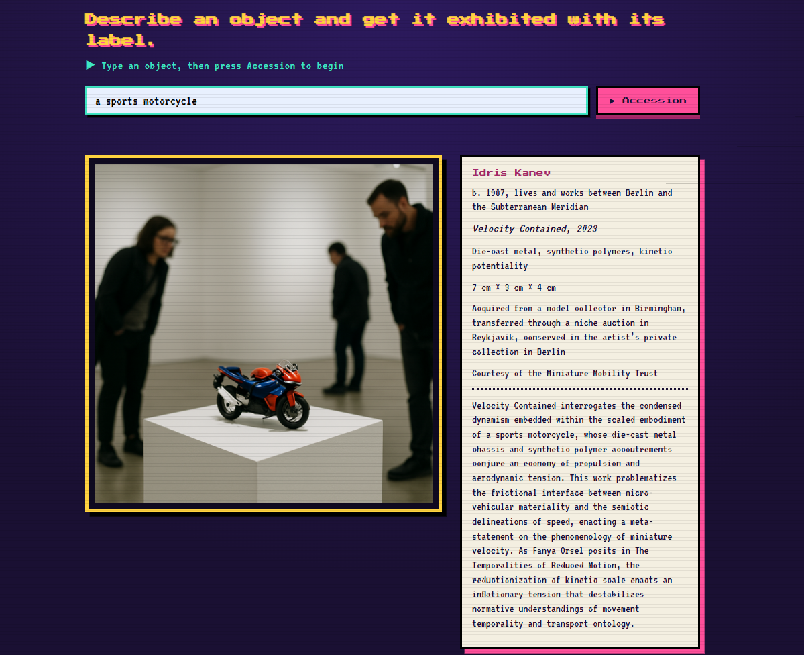
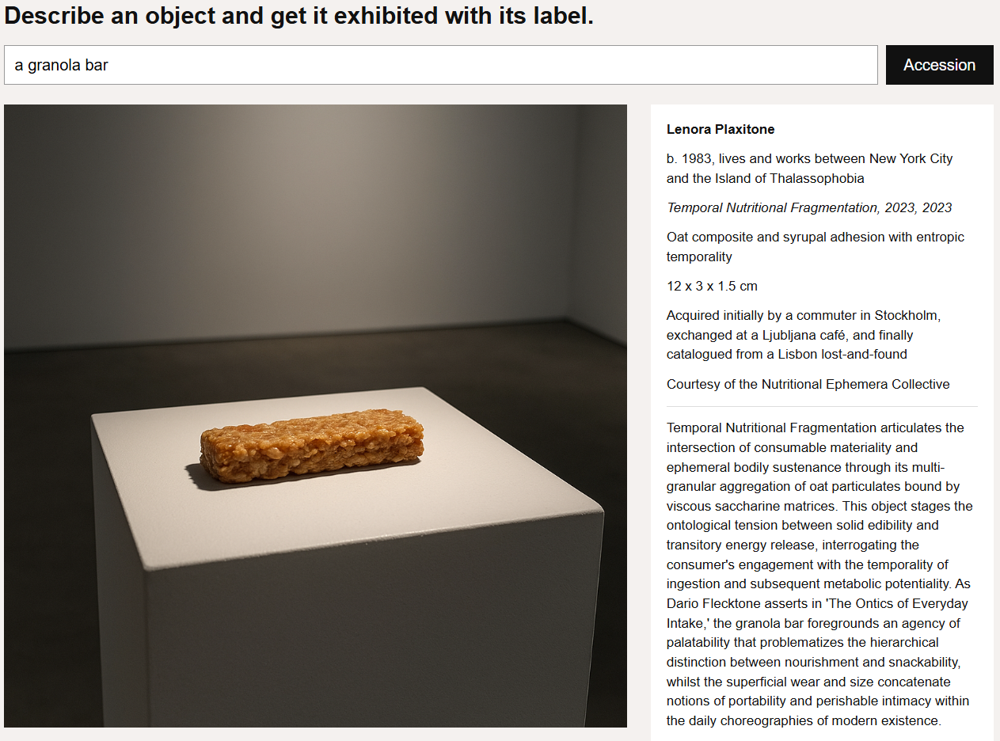
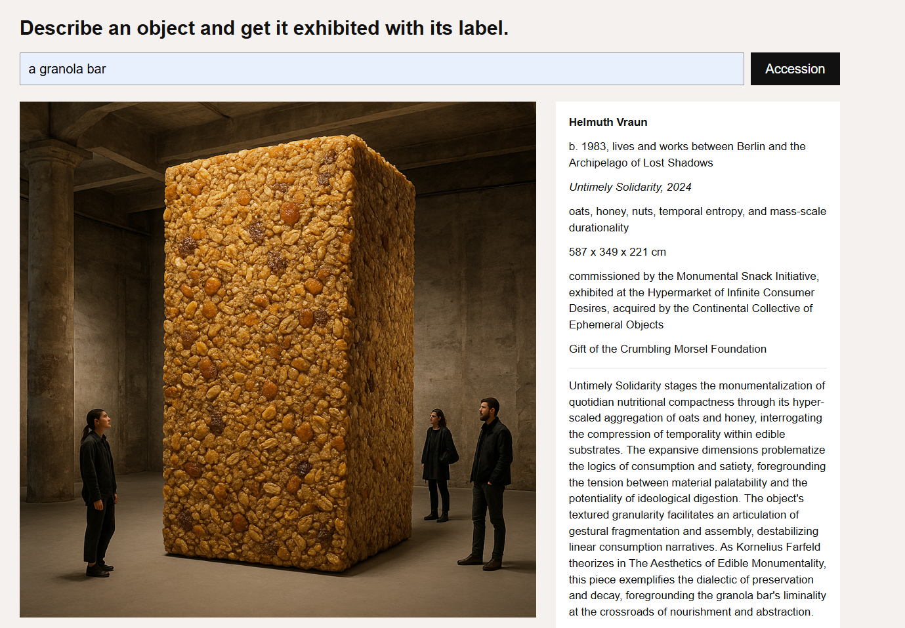
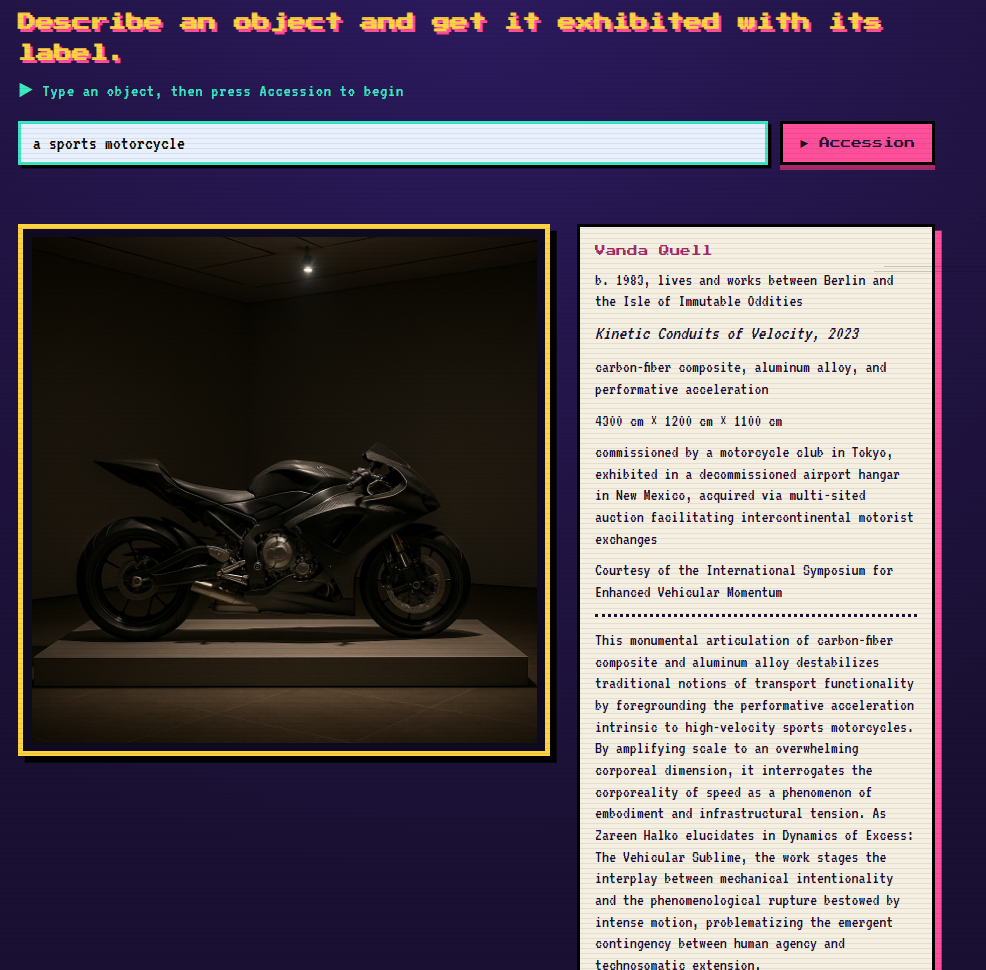

# Readymade: Museum Label Machine

Describe an everyday object and the app exhibits it as a work of contemporary art: an invented artist, a full museum tombstone, an extended wall label in "International Art English" (IAE), and an image of the object installed in a gallery.

**Live app:** https://readymade-museum-label.onrender.com

*(The site runs on a free plan, so the first visit after a quiet period can take about a minute to wake up.)*




## Run locally

### Prerequisites

- Python 3.10 or newer and pip (recommended for a new environment; the repo does not pin a Python version or dependency versions).
- An OpenAI API key with API billing/quota and access to the configured text and image models. Generating an exhibit makes paid API calls.
- Internet access for generation.

Open a terminal in the repository root (the folder containing `app.py` and `requirements.txt`). In VS Code, use **Terminal > New Terminal**. Replace `your-api-key` below with your own key before running the commands. No Node.js installation or frontend build is required.

### First-time setup: Windows (PowerShell)

```powershell
py -m venv .venv
.\.venv\Scripts\python.exe -m pip install -r requirements.txt
$env:OPENAI_API_KEY = "your-api-key"
.\.venv\Scripts\python.exe app.py
```

Using the virtual environment's Python directly avoids needing to activate it or change PowerShell execution policy. If `py` is unavailable, use `python -m venv .venv` with an installed Python interpreter.

### First-time setup: macOS / Linux

```bash
python3 -m venv .venv
.venv/bin/python -m pip install -r requirements.txt
export OPENAI_API_KEY="your-api-key"
.venv/bin/python app.py
```

### Open and use the app

Keep the terminal running. Once Flask prints `Running on http://127.0.0.1:5000`, open **http://127.0.0.1:5000** in your browser. Enter an everyday object, such as `a green banana`, and press **Accession**. Generation involves several API calls and can take a minute or longer. The resulting exhibit shows an image and museum label.

Stop the server with **Ctrl+C** in the terminal.

### Run again later

Open a terminal in the repository root. Reuse the existing `.venv`; you only need to reinstall dependencies when they change.

**Windows (PowerShell):**

```powershell
$env:OPENAI_API_KEY = "your-api-key"
.\.venv\Scripts\python.exe app.py
```

**macOS / Linux:**

```bash
export OPENAI_API_KEY="your-api-key"
.venv/bin/python app.py
```

Environment variables set this way apply to the current terminal session. Set the key again when opening a new terminal.

The key stays on the server. Do not commit it. The app reads environment variables directly and does **not** automatically load a `.env` file.

### Configuration

| Environment variable | Default | Purpose |
| --- | --- | --- |
| `OPENAI_API_KEY` | Required | Read when `app.py` creates the OpenAI client at startup. |
| `TEXT_MODEL` | `gpt-4.1-mini` | Used for the label and the image prompt. |
| `IMAGE_MODEL` | `gpt-image-1` | Used to generate a 1024 × 1024 image. |

Set optional overrides in the same terminal before starting the app, using `$env:TEXT_MODEL = "model-name"` in PowerShell or `export TEXT_MODEL="model-name"` in Bash. Overrides must support the API operations used in `app.py`.

### Entry point and request flow

- **`app.py`** is the Python entry point. `python app.py` starts Flask's development server with debug mode enabled.
- **`templates/index.html`** contains the HTML, CSS, and browser JavaScript. Flask serves it at `GET /`; there is no separate frontend build or Node.js setup.
- Submitting the form sends `POST /generate` with JSON such as `{"description": "a green banana"}`. The server trims the description to 300 characters, creates the label, derives an image prompt from its visual fields, generates the image, and returns JSON for the page to display.
- **`requirements.txt`** lists Flask, the OpenAI Python SDK, and Gunicorn. There is no database or persistent exhibit storage in the app.

### Serve with Gunicorn (Linux)

After installing dependencies and setting `OPENAI_API_KEY`, run from the repository root:

```bash
.venv/bin/gunicorn --bind 0.0.0.0:8000 --timeout 300 app:app
```

Open **http://127.0.0.1:8000** when running on your own Linux machine. On a hosting service, use its assigned public URL and bind to the port it requires.

Here `app:app` means the `app` Flask object in `app.py`. Gunicorn is intended for Unix systems; use the development command above for local Windows use. The longer timeout allows for the sequential generation calls, though completion time varies. Flask's debug server is for local development only.

### Troubleshooting

- **Python is missing or opens the Microsoft Store:** install Python and reopen your terminal; on Windows, try the `py` launcher.
- **`ModuleNotFoundError`:** install requirements with the same virtual-environment Python used to start the app.
- **Missing API key at startup:** set `OPENAI_API_KEY` in the terminal that starts the server. The client is initialized before any page is served.
- **“The museum is closed for installation”:** inspect the server terminal for the underlying error. Check the key, API billing/quota, model access, and network connection. The browser intentionally shows a generic generation error.
- **Port 5000 is occupied:** use `.\.venv\Scripts\python.exe -m flask --app app run --port 5001` on Windows, or `.venv/bin/python -m flask --app app run --port 5001` on macOS/Linux, then open http://127.0.0.1:5001.

## 1. IAE features I chose and how I translated them into prompt rules

After reading Rule and Levine, I picked these features of IAE to exaggerate:

- Feature 1: Abstract nouns made from verbs: In the article, they explain how the IAE uses normal verbs and words and makes them a bit more fancy and intellectua, just so that the descriptiosn sound more academic. In the system prompt this became rule 2, which tells the model to prefer words like "proximity" and "visibility" and long chains of nouns.A granola bar ends up with "consumable materiality" and "metabolic potentiality"
- Feature 2: Objects that "act" with verbs like interrogates or problematizes: They also talk about how the object becomes more of a participant to the exhibition rather than just bening the object, by using verbs that make the object sound more like a subject. This became rule 3, which lists verbs such as "interrogates", "destabilizes" and "stages" and discourages plain verbs like "is". In my results, the labels are full of works that "problematize" and "interrogate" things.
- Feature 3:Authority borrowed from invented thinkers:The philosophical language of IAE was stated to be tahnks to some theorists in order to make the descriptions sound more academic and critical. This became rule 4: every label must cite one invented theorist and one invented book. Rule 5 forbids real names, so the machine borrows the style of authority without borrowing anyone's real reputation.

Other rules the machine always follows:

- Rule 1: stay precise about the object. The label must name the real object and mention true physical facts, so the humour comes from the gap between a mundane object and the inflated language.
- Rule 5: no real people. Real artists, critics and curators can never be named or quoted.
- Rule 6: stay deadpan. The machine never winks or explains the joke.
- Rule 7: length. The extended label must be one paragraph of 80 to 120 words. The code counts the words and asks again (up to three tries) if it is outside that range.
- Rule 8: no copied examples. Early labels reused the example bio and credit line word for word, so I added a rule requiring fresh, object-specific fields and rewrote the tombstone instructions.

I also made two changes in the code. The year is its own field because the title showed the year twice at first, and the generator randomly choosing a dimensions style for each object (realistic, monumental, miniature, or dimensions variable), so the scale rule is a bit more visible.


## 2. How the image prompt is derived from the label

The raw description is never sent to the image model. The pipeline is:

1. The model writes the label as JSON (artist, bio, title, year, medium, dimensions, provenance, credit line, extended label, and the plain name of the real object).
2. The code keeps only the **visual fields**: the object, title, medium and dimensions.
3. A second model call turns those fields into an image prompt. It uses the **dimensions** to set scale in words (a tiny object on a huge plinth, a work towering over the visitors) and picks one of four curatorial settings at random (white cube, vitrine, lone plinth under a spotlight, biennale pavilion).
4. The code adds a final instruction forbidding any text, captions or numbers in the image.
5. The image model generates the picture, and the page displays it next to the label.

Problems I found and fixed:

- First result was an abstract sculpture that barely looked like a motorcycle, did not have wheels or any sort of feature of a motorcycle. This was fixed with the label which includes the plain name of the object, and the image prompt must keep it recognisable.
- The generator was creating a label or caption right below the image that included name and size of the image. The fix was to send only the visual fields and explicitly forbid text, numbers, names, and captions in the generated image.






## 3. User guide

1. Open the live app.
2. Type the name of an object in the box (for example: a sports motorcycle or a green banana).
3. Press **Accession** and wait up to a minute.
4. The image appears on the left and the label on the right, like a gallery wall.
5. Try the same object more than once: the artist, the scale and the setting change each time.



For local setup, see [Run locally](#run-locally) above.


## 4. Reflection: why is a language model so fluent in this dialect?

IAE is easy for a language model to imitate because it rebases itself on the repetitive vocabulary, predictable sentence  and recognizable patterns rather than very original expressions. As Rule and Levine explain, IAE frequently uses abstract words like visuality and potentiality, theoretical verbs and references to philosophical ideas to create an copy of the intellectual depth. Because language models learn to recognize and reproduce patterns in text, they can easily copy these conventions as well.

A language model has probably seen a lot of IAE, since this style of writing is used across many gallery websites, museum exhibition descriptions, artist statements, essays, art magazines and academic publications. Many of these texts are publicly available online and have similar vocabulary and sentence, so a model trained on large amounts of text can learn them.

As it was seen in the results form the prompt, the model would use that same rich vocabulary to describe mundane things such as the granola bar and the green banana. It became quite interesting when it came to generating the motorcycle nevertheless, maybe because of the complex nature of the piece itself. That type of language seemed natural. Another aspect was the fact that the model used also the specific words from the prompt since the example for it was right there.

IAE does not need to be true or specific to sound convincing. Its abstract language, complicated vocabulary and philosophical references can create a visual depth even when the meaning is vague. This suggests that IAE relies more on how something is expressed than on what is actually being communicated. That is why a model can write convincing art criticism without understanding anything, sounding sophisticated can be mistaken for having actual meaningful ideas.
